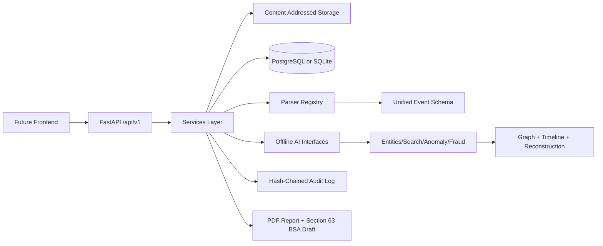

# Parakh

Parakh is a backend-first prototype for an **AI-powered indigenous digital forensics investigation framework**. It ingests exported digital artifacts, preserves evidence integrity, parses records into a unified event schema, checks authenticity signals, extracts India-specific entities, correlates events, reconstructs incidents, and exports a court-ready report draft.

It is inspired by investigator workflows such as evidence collection, multi-device analytics, case collaboration, OSINT-style enrichment, and AI leads with source traceability. It does **not** implement device exploitation, lock bypass, spyware, or invasive acquisition. It only ingests exported files/logical artifacts.

## Architecture



## What Works Now

- JWT auth with RBAC roles: admin, investigator, analyst, prosecutor.
- Case creation and membership-ready schema.
- Evidence upload with SHA-256, MD5, immutable local content-addressed storage, and idempotency key support.
- Parser plugin registry with default parsers for WhatsApp exports, CSV logs/statements, browser SQLite, EML/MBOX, images, PDFs, generic logs, and GPS JSON.
- Unified `Event` schema across sources.
- Hash-chained chain-of-custody audit log with verification endpoint.
- Authenticity reports for evidence with image, PDF, chat, and integrity checks.
- India-specific entity detection: +91 phones, UPI IDs, IFSC, PAN, Aadhaar-pattern detection with Aadhaar masking.
- Keyword search, anomaly rules, fraud rules, entity graph, timeline, and incident reconstruction with citation enforcement.
- Comments, leads board, and PDF report export.
- Synthetic demo data generator for an investment/UPI scam.

## Future Work / Prototype Stubs

- Deepfake and AI-image detection is exposed as a labelled detector interface stub with simple heuristics.
- Local LLM/Ollama and multilingual embedding providers are represented by clean interfaces in the design; this prototype uses deterministic offline defaults.
- OSINT enrichment is intentionally a stub concept only, because the current build is offline-first and no external calls are mandatory.
- PostgreSQL, pgvector/FAISS, MinIO, Celery/RQ, and Neo4j can replace the local defaults behind the existing service boundaries.

## Quick Start

```bash
cd ~/Desktop/parakh/backend
python3.11 -m venv .venv
source .venv/bin/activate
pip install -r requirements.txt
python -m app.cli generate-demo-data
python -m app.cli seed-demo
uvicorn app.main:app --reload
```

Open:

- API docs: http://127.0.0.1:8000/api/docs
- Placeholder UI: http://127.0.0.1:8000/

Default dev seeded user:

- username: `admin`
- password: comes from `DEMO_ADMIN_PASSWORD`; dev fallback is `admin123`, production refuses defaults.

## Demo Walkthrough

1. Generate synthetic data:

   ```bash
   python -m app.cli generate-demo-data
   ```

2. Seed the demo case:

   ```bash
   python -m app.cli seed-demo
   ```

3. Login using `/api/v1/auth/token`.

4. Explore:

   - `/api/v1/cases`
   - `/api/v1/cases/{case_id}/evidence`
   - `/api/v1/cases/{case_id}/events`
   - `/api/v1/cases/{case_id}/entities/extract`
   - `/api/v1/cases/{case_id}/fraud`
   - `/api/v1/cases/{case_id}/graph`
   - `/api/v1/cases/{case_id}/timeline`
   - `/api/v1/cases/{case_id}/reconstruction`
   - `/api/v1/audit/verify`
   - `/api/v1/cases/{case_id}/reports`

## Section 63 BSA Certificate Draft

Generated reports include a **draft only** Section 63 BSA 2023 electronic-evidence certificate note. Investigators must verify wording, jurisdiction, and admissibility requirements with qualified legal counsel before court use.

## Tests

```bash
pytest
ruff check .
mypy app
```

## API Groups

Routes are versioned under `/api/v1` and grouped as:

`auth`, `cases`, `evidence`, `events`, `entities`, `search`, `authenticity`, `anomalies`, `fraud`, `graph`, `timeline`, `reconstruction`, `leads`, `reports`, `audit`.

## Data Handling

- No telemetry.
- No mandatory external API calls.
- Evidence is stored locally by SHA-256.
- Originals are treated as immutable.
- Audit actions are hash-chained and verifiable.
- Aadhaar-like values are masked when extracted.
